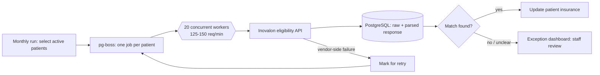

# Monthly insurance checks for 1,000–2,000 patients, down to a few dozen to review

**Live:** none (employer work) · **Code:** none public · **Skills proven:** TypeScript, Node.js, PostgreSQL, pg-boss, React, Inovalon API, Idempotency, Asynchronous jobs

## The story
**Context.** Kyros serves substance use disorder treatment patients, and every active patient's insurance has to be re-verified monthly. For 1,000–2,000 active patients, a team of 3–5 billing staff, who sat right behind me, spent parts of the first few weeks of each month working through different insurer portals and a shared spreadsheet, on top of their other duties.

**My role and constraints.** I joined the effort partway through, as architect and primary implementer, working largely on my own through engineering and product turnover and reporting progress directly to upper management. Inovalon was already chosen and contracted. My manager favored pg-boss for the workers, so I wrote an RFC comparing the options: AWS services, or adding pg-boss (a PostgreSQL-backed job queue) to the stack inside the monolith. I recommended SQS with Lambda. Queueing and worker behavior would be visible out of the box, with dead-letter queues built in; it was a more targeted fit for this kind of job, it kept worker and deployment concerns out of the monolith, and it kept extra load off a PostgreSQL database we were still cleaning up. The strongest case for pg-boss was that its abstractions could be hidden behind simple interfaces, which made it easier for a team with several junior engineers to share the work. The two lead engineers, who gave most of the feedback, agreed pg-boss made the most sense for the team, and we went with it. Sometimes the best answer is the one the most people on the team can work with confidently. From there the constraints were pg-boss, Inovalon and building into the existing monolith. The external eligibility API (Inovalon) answered in anywhere from about 200 ms to five minutes. Patient health data set the rules for what moved where.

**How a run works.**
1. Select active patients using clinical, activity-based criteria.
2. Queue each patient as an individual request to Inovalon.
3. Save the raw response and parse it; Inovalon can return up to three ranked insurances.
4. A worker updates the patient's insurance where needed.
5. Misses appear on a dashboard. Staff can open any active patient's insurance, correct it, or switch to the second or third option.
6. Requests that failed on Inovalon's side (not for missing patient data) are rerun. These usually failed in batches.

Inovalon was wary of anything over 200 requests per minute, so I capped the run at 20 concurrent workers, which held traffic around 125–150 requests per minute. Very slow responses were rare and usually meant an error on their side, so the priority was failing gracefully and marking the patient for retry. A full run took about 7–16 minutes.

**Key decisions.**
1. Build for long-running, unreliable external calls: idempotent jobs, handling of partial completion and recovery, so a run could fail midway and resume without double-checking or skipping patients.
2. Earn trust before relying on automation: staged manual review that the billing team could verify against their own results before the automated path took over.
3. An explicit exception path instead of a claim of full automation: an exception queue surfaced unresolved cases, staff resolved them with the methods they already used, and escalated to patient outreach when data needed correcting.
4. Reuse the same machinery for onboarding: eligibility checks triggered when a patient is onboarded, not only in the monthly run.

**What went wrong.** Real responses often didn't match the test data or the documentation. Dates and formats came back in shapes that needed extra parsing, or turned out to mean something else; one date field had to be parsed to work out location where we expected a time zone. Fields documented as required often came back blank. Because every raw response was saved beside the parsed result, a parse that failed or came back empty could be traced to the exact payload, the parser fixed, and saved responses re-parsed without asking Inovalon again.

**The turning point.** For a while I was stuck on the limits of Inovalon's legacy system. What broke it open was going on the offense: I pushed past their rate limits in their test environment on purpose to provoke as many errors as I could, then handled each failure mode until the harness was ready for whatever their system did. With no project manager over me for part of this, I was also the main contact for the project, which meant building a working line of communication with Inovalon and keeping leadership informed with honest timelines.

**Result.** After about three months of staged rollout, runs were routine: about 7–16 minutes for 1,000–2,000 patients. Before, each of the 3–5 billing staff spent a few days a month on the check; after, a typical run flagged a few dozen patients for review, and only a handful needed follow-up at check-in to get more information. Billing staff moved from checking every patient to resolving targeted exceptions. Kept iterating on dashboards and exception workflows as new markets and insurance requirements came in. I reused the engine for eligibility checks at patient onboarding, scoped that piece for a junior engineer, and handed it off; they refined it with the onboarding team while I kept tuning the monthly runs.

## The evidence
- Architecture diagram (from the confirmed run flow):

- How retries and idempotency worked: each patient was one job per monthly run, so re-queuing a run or a failed batch didn't double-check or skip anyone; a vendor-side failure marked the patient for retry and the batch was rerun, while a failure caused by missing patient data went to the exception dashboard instead of being retried.
- What I'd do next: measure it. Record run time and exception counts every month, and ask staff to log their remaining review time, so the time saved is a number rather than an estimate.
