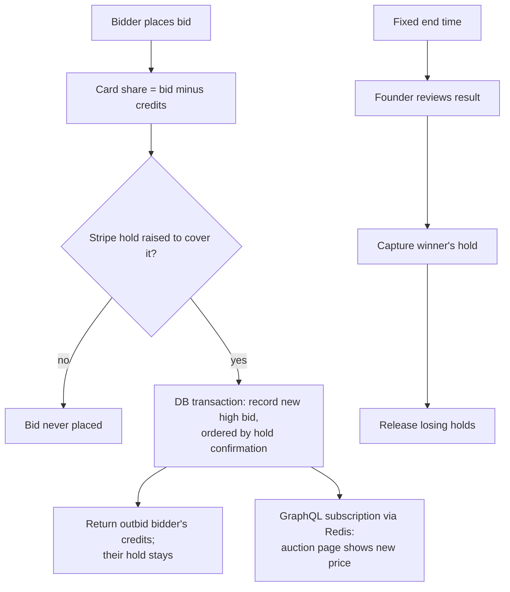

# Real-time auctions where every bid was backed by a Stripe hold

**Live:** none (employer work) · **Code:** none public · **Skills proven:** TypeScript, Node.js, GraphQL subscriptions, Apollo Server, TypeGraphQL, Stripe API, PostgreSQL, Prisma, Redis, Jest, Docker, AWS ECS

## The story
**Context.** HYP sold limited-release collaborations between brands and influencers or artists through live auctions. The idea came from the sneaker resale market: when a famous person wears an old, quietly released shoe, resale prices jump, mostly on auction sites. HYP wanted to create that hype on purpose. The auction mechanics weren't the novel part; the partners and the people were. That meant the bidding had to be boringly correct: a high bid on screen had to be money that would actually arrive.

**My role and constraints.** I was one of two founding engineers, peers, reporting to the founder. A dev shop had built a proof of concept; we restarted from scratch. The two of us turned the founder's goals into tickets in Linear, split them by who wanted what, and reviewed each other's pull requests under Git Flow; two contractors took a lane of tightly specced tickets around parts we had already architected. The stack: a Node.js and TypeScript GraphQL API on Apollo Server with TypeGraphQL, PostgreSQL through Prisma, Redis, and a Next.js frontend on Vercel, with the backend in Docker on AWS ECS. There was very little design support, and the founder wanted a release, which made scope decisions about utility and getting to a safe launch.

**How a bid works.** Auctions ran for about a day.
1. A bidder saves a card once (and can add more cards to back higher bids), then places a bid.
2. The server works out the card's share: the bid minus any promotional credits applied. Users earned credits for onboarding and sharing, and a bid could be funded entirely by credits. Credits lived in our PostgreSQL database, not in Stripe.
3. The server asks the Stripe API to hold that amount on the card. Each bidder had one hold, raised as they bid higher. If the hold doesn't go through, the bid is never placed, so a failed payment never reaches the auction.
4. Inside a database transaction, the bid is recorded as the new high bid, ordered by when Stripe confirmed the hold.
5. A GraphQL subscription, with events carried through Redis, pushes the new price to everyone watching; the price ticks up with a short animation.
6. An outbid bidder gets their credits back but keeps their hold, so they can bid again without starting over.
7. At the fixed end time, the highest bidder wins. While volume was low, the founder reviewed every result by hand, and the winner's hold was captured shortly after.

**Key decisions.**
1. **Guarantee the money before accepting the bid.** Instead of building recovery for failed payments after an auction, a bid only counted once a Stripe hold covered it. Stripe's checks did the work of catching declines, and the auction only ever held bids that could be paid.
2. **Order bids by when the money was confirmed.** A database transaction wrapped each bid so two bids couldn't leave the auction in a crossed state, and the timestamp that counted was when Stripe confirmed the hold. If two near-simultaneous bids could both stand, both did; if not, the first won, and the other didn't count, with no hold left on that bidder's card for it.
3. **One hold per bidder for the life of the auction.** Raising a bidder's hold as they bid higher, and keeping it when they were outbid, meant a returning bidder didn't need a fresh authorization. A one-day auction sat well inside Stripe's roughly 7-day hold window. Losing bidders' holds were released once the winner's hold was captured.
4. **Keep a human in the loop at the close.** With early volume small, the founder reviewing each result was cheaper and safer than automating every edge case before launch.

**What went wrong.** Stripe's API was good; the real-time part was what made it hard to trust. Holds, bids and live updates all moving at once makes you check and recheck everything. We knew going in that Instagram's API was a weak spot for the identity side of the product and accepted it.

**How we built confidence.** We concentrated Jest tests on the mission-critical paths rather than chasing a coverage number, and reached about 75% overall. Then we ran dozens of small test auctions, including about ten rounds with about ten people on multiple accounts each, simulating about 25 users at a time, and two soft launches. CircleCI built Docker images and deployed them to ECS through an internal npm package the two of us wrote; GitHub Actions ran tests and linting on every change.

**What I'd do differently.** Spend more time at the start understanding the founder's priorities. A lot of early effort went into the features every auction site has, and that sometimes came at the expense of iterating on the auctions themselves, which were what made HYP different. Knowing that sooner, I'd have pushed to ship simpler auctions early and iterate on them while the rest was built out.

**Result.** The product launched after about 15 months, right as my time at HYP ended. There are no post-launch numbers to report.

## The evidence
- Bid flow diagram (outbid holds stay in place until the close):

- Live updates: GraphQL subscriptions with Redis carrying events, on one backend server; most likely served over a WebSocket beside Apollo Server 3 with `graphql-ws`, since Apollo Server 3 dropped built-in subscriptions.
- Tests and CI: Jest on the mission-critical paths (about 75% coverage); GitHub Actions on every change; CircleCI for image builds and deploys
- What I'd do next: ship a simpler auction early and iterate on it while the rest is built (see What I'd do differently)
